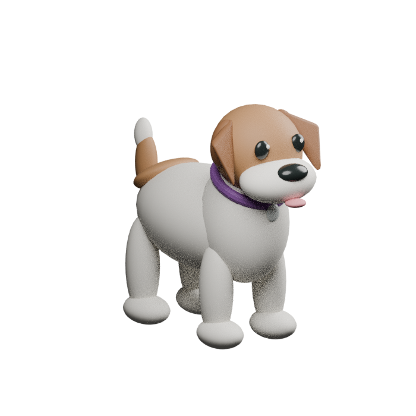
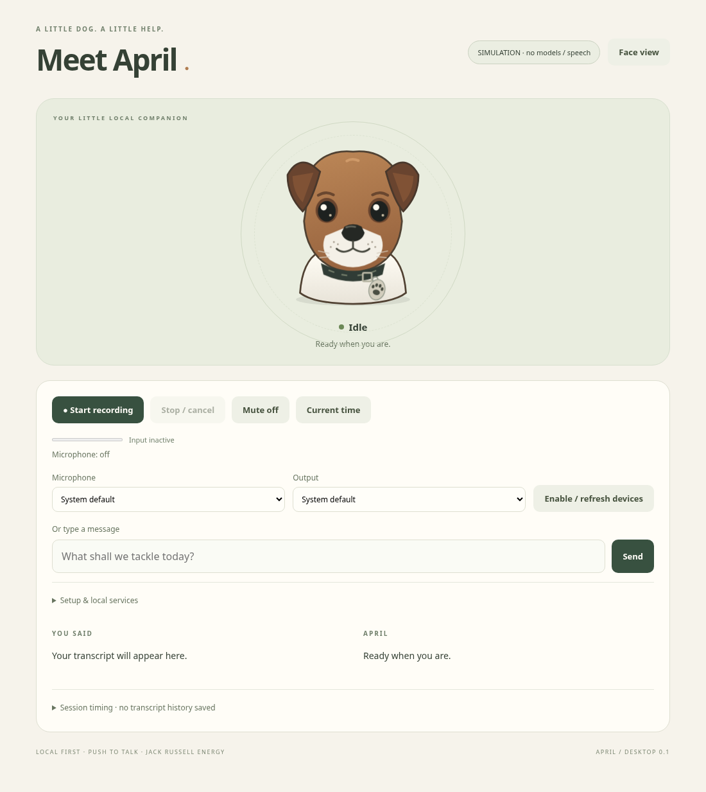
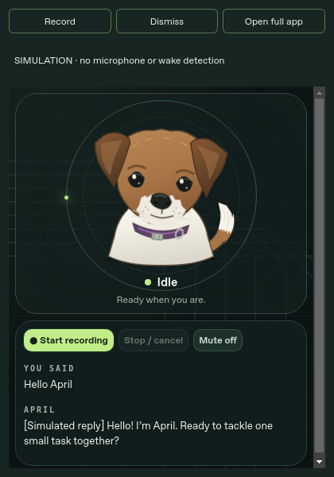
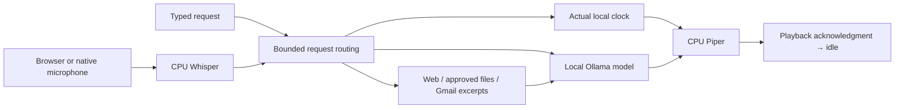

# APRIL · Local voice companion

A voice companion inspired by Enrique’s Jack Russell terrier, built with Python,
local speech models, Ollama and an expressive dog interface. APRIL explores
interactive systems, audio integration and reliable software design using
pretrained models. It does not train or fine-tune them.

Built by **Enrique**, a George Mason University computer science student
expecting to graduate in **May 2028**.

**Current milestone:** a user-tested desktop voice assistant, approved-folder
retrieval and source-cited web search, plus an optional native “Hey April” tray
widget with login/shutdown acceptance in progress. Enrique confirmed native
wake activation and explicit Obsidian memory recall after restart. The long-term goal is an always-on
Raspberry Pi companion with authenticated desktop acceleration.

[Project progression](docs/PROGRESS.md) · [Widget setup](docs/WIDGET.md) ·
[Validation](docs/VALIDATION.md) · [Architecture](docs/ARCHITECTURE.md) ·
[Roadmap](docs/ROADMAP.md) · [Personality & memory](docs/MEMORY.md) · [Obsidian & shared agents](docs/OBSIDIAN.md) · [Everyday desktop setup](docs/EVERYDAY_SETUP.md)

## New personal-companion preview

[Full setup and updated goals](docs/ASSISTANT.md) cover managed on/off, an original
replaceable 3D terrier, explicit screen/code review, a self-hosted CalDAV calendar
and private email/calendar recaps. The [guided everyday setup](docs/EVERYDAY_SETUP.md)
now discovers the existing model store, registers managed login startup, verifies
CalDAV, and walks through Google consent. It also enables more conversational
context and shows automatic-memory progress.

**New: [persistent personal memory](docs/MEMORY.md).** April has a cheerful female
Jack Russell persona, bounded recent context, background local extraction of
selected personal facts and an editable Markdown vault. Obsidian is optional.
Use **My memories** or say “Remember this…” / “What do you remember about me?” /
“Don’t remember this conversation.” Explicit reminders and opt-in daily briefing
notifications are local; Pi synchronization remains a later milestone.



The uploaded MP4 informed this original procedural prototype; it was not an
editable mesh and was not converted into the video's original asset. The Blender
source and GLB are included. [Edit/replace the model](tools/README.md).

After one-time dependencies and readable existing model-store configuration:

```bash
bash april.sh start
bash april.sh status
bash april.sh stop
```

Managed startup owns a private Ollama process, search, optional local CalDAV and
the native client. **Goodbye April** / Off stops owned services and pauses login
startup until a manual start. Shared AM/Ollama/Docker services are preserved.
Reinstall the autostart entry after upgrading. Real desktop power/wake/screen
portal behavior and personal Google consent remain pending.

## What works, and what is still pending

| Capability | Evidence / current status |
|---|---|
| Desktop microphone → Whisper → GPT-OSS 20B → Piper → audible reply | Enrique reported five successful real sessions on CachyOS; numerical timing samples were not supplied |
| Expressive Jack Russell face, AM-style animated circuits, tongue and white-tipped tail | Original SVG/CSS; real browser and native simulation captures below |
| Recording bounds, serial requests, cancellation, retry and actionable errors | Automated fixtures and browser regressions; repeated physical cancellation measurements pending |
| Actual time/date | Deterministic clock routing for recognized spoken/typed requests and the clock button |
| Approved-folder RAG | SQLite FTS5 retrieval; Enrique confirmed access to his approved `~/Documents/aprilfiles` folder |
| Automatic web lookup and visible sources | Citation markers remain visible but are omitted from spoken audio. SearXNG; desktop screenshot shows three retrieved sources and a cited answer |
| Native popup, tray controls, wake listener and login startup | Enrique confirmed native wake activation. Qt/fake-audio/owned-process fixtures passed; reboot/login, focus and broader wake accuracy acceptance pending |
| Read-only Gmail | OAuth/search adapter and fixtures implemented; personal consent and real mailbox queries pending |
| CalDAV calendar and private recaps | Reviewed create/edit and bounded calendar/email briefing implemented; authenticated Radicale tests passed. Personal setup pending |
| Screen/code assistance | Explicit local OCR snapshot, approved Python-file review, separately approved container run and VS Code preview; desktop/IDE acceptance pending |
| Personal memory | Markdown vault + SQLite lexical recall, local extraction, review/edit/forget/private controls, explicit reminders and opt-in briefing notices; Enrique confirmed explicit save/Obsidian/restart recall; automatic selection quality remains pending; follow-up context and private-mode fixtures passed |
| Navidrome | Planned; not implemented |
| Standalone Pi inference and desktop offload/fallback | Planned; physical Pi operation is not verified |

Latest recorded validation: **93 automated tests**, Chromium playback/source regressions,
actual offscreen Qt widget checks, and clean native-launcher shutdown on SIGINT
and SIGTERM. These do not substitute for real microphone/model/Pi tests.
See [the evidence record](docs/VALIDATION.md).

## See April



April’s broad tan forehead, folded ears, dark eyes, white muzzle/chest and purple
collar follow the supplied dog photos. Her short brown tail has a white tip and
angled top. Her tongue shows while listening/thinking; her mouth closes at idle.
The tail follows detected input level or actual playback. Expressions represent
interaction state, not model reasoning; speech animation is not phoneme lip sync.
Reduced-motion preferences are respected.

[Full-screen face](docs/evidence/simulation-face-view.png) ·
[Labeled simulation walkthrough](docs/evidence/simulation-walkthrough.webm)



**Both images and the bundled walkthrough are simulation evidence.** Personal
reference photos are not bundled. A real desktop walkthrough remains pending.

## Start on an already-configured desktop

Stop an existing APRIL instance with Ctrl+C before switching clients.

```bash
cd ~/Projects/April
git pull --ff-only
bash april.sh --with-search
```

Open the localhost address printed in the terminal and refresh after updates.
This checks speech/model prerequisites, starts only APRIL’s SearXNG container,
and launches the live browser app. Docker and Ollama must already be running and
accessible; the launcher does not start/stop shared services or unload models.

```bash
bash april.sh                      # App only; search service already running
bash april.sh --check              # Read-only speech/model prerequisites
bash april.sh --simulation         # Clearly labeled fixtures; no model/speech
bash april.sh --widget --with-search # Native companion, after optional setup
```

Existing ignored `april.local.toml` is preserved. If absent, live startup copies
the desktop example profile. Configure paths/devices/timeouts there or select a
different file through `APRIL_CONFIG`. Checks establish prerequisites, not model
integrity, successful inference or search-engine availability.

## First installation

The tested desktop environment uses **Python 3.12**. Use an isolated environment;
do not replace CachyOS system Python. Git, a modern browser and C/C++ build tools
are needed. No hardware purchases or search API keys are required.

```bash
git clone https://github.com/Ejozef13/April.git
cd April
bash scripts/setup.sh
bash scripts/setup_speech.sh
```

Prepare speech/voice models using [STACK.md](docs/STACK.md), and search using
[SEARXNG.md](docs/SEARXNG.md).

| Component | Desktop profile |
|---|---|
| LLM | Existing `gpt-oss:20b` through loopback Ollama; low reasoning, 4096 context, 512-token budget |
| STT | CPU whisper.cpp; `.tools/whisper.cpp/build/bin/whisper-cli` and `ggml-base.en.bin` |
| TTS | CPU Piper; `models/en_US-ljspeech-medium.onnx` and matching `.onnx.json` |
| Capture | Browser-selected input or optional native PortAudio input; maximum 15 seconds |
| Response | Maximum 600 visible/spoken characters; generation budget includes reasoning |
| Deadlines | 90-second processing and 60-second playback deadlines |
| Search | Dedicated loopback SearXNG container; up to three bounded excerpts |

Inspect existing `ollama list`, `ollama ps`, RAM/VRAM and shared AM workloads
before changing models. CPU speech avoids assuming CUDA support or enough VRAM
for several models. [Desktop profile](april.desktop.example.toml) ·
[General configuration](april.example.toml).

## “Hey April” widget and login startup

The optional client lives in the system tray and shows April’s face when called.
It uses a CPU Vosk wake recognizer, bounded native recording and the same local
voice pipeline. Record, microphone pause, dismiss and quit remain accessible.

Follow [WIDGET.md](docs/WIDGET.md) for dependencies, model licensing, configuration
and the real-device test. First install and test manually:

```bash
sudo pacman -S --needed portaudio
bash scripts/setup_desktop.sh
.venv/bin/python -m april.wake_setup --download
bash april.sh --widget --with-search
```

Say **“Hey April”**, pause for the popup, then **“What time is it?”** Same-breath
wake-plus-command is not reliably supported. Native recording ends after silence.
Wake listening pauses during processing/playback. The widget uses the system
default output; native input names differ from browser device IDs.

After that test passes, opt into startup **after desktop login**:

```bash
sudo systemctl enable --now docker ollama
.venv/bin/python -m april.autostart install
```

The installer writes only APRIL’s managed XDG autostart entry. It does not change
your actual PC from the cloud. Remove that entry with
`.venv/bin/python -m april.autostart remove`. Closing the window dismisses it;
explicit Quit exits and releases the owned server/microphone. KDE Wayland popup
focus and real login behavior remain pending physical tests.

## Conversation, grounded answers and controls

In the browser, grant microphone permission, select the input, press **Start
recording**, speak and press **Finish recording**. Submission is automatic; Send
is for typed messages. Alt+R records; Escape or Stop/cancel cancels. Mute controls
reply audio, not the native wake listener. Use tray **Pause microphone** for that.

States are idle, listening, transcribing, thinking, speaking and error. Speaking
begins only after playback starts. Play reply retries blocked playback without
another model request. One global job runs at a time; no application backlog is
accepted. A failed turn can be retried without restarting the app.

Ordinary live questions retrieve web evidence automatically. Recognized clock
requests use the real local clock. “Search my files for …” and “Search my emails
for …” use dedicated private routes. Sources are shown separately from model
prose. Failed/empty searches do not silently fall back to unsupported model facts;
snippets can still be incomplete, stale or misinterpreted.

Common private cues suppress automatic web search, but this is a heuristic, not
a complete sensitive-data detector. Ordinary web questions go to upstream search
engines; retrieved private excerpts are never automatically forwarded as queries.
Set `automatic_web_search = false` and restart for local conversation with manual
search controls; current-fact guards still require retrieval.

[Folder/Gmail setup and retention](docs/INTEGRATIONS.md) ·
[Search setup](docs/SEARXNG.md) · [Accuracy limitations](docs/ACCURACY.md).

## Engineering and validation



The optional local wake detector precedes native command capture. The diagram
shows software paths; Gmail still requires personal account acceptance.

```bash
.venv/bin/python -m unittest discover -s tests -v
# Optional browser checks: invoking environment needs Playwright and Chromium.
.venv/bin/python scripts/browser_playback_check.py
# Optional native checks: desktop dependencies; simulation, no real microphone.
.venv/bin/python scripts/widget_smoke.py
.venv/bin/python scripts/widget_lifecycle_check.py
```

Timing JSON exports contain stage timings/configuration and playback outcome,
not transcripts or raw audio. Server totals exclude recording, transport and
playback. No collected multi-run hardware benchmark is available.
[Timing protocol](docs/BENCHMARKS.md) ·
[Desktop acceptance and real walkthrough](docs/DESKTOP_ACCEPTANCE.md) ·
[Interview guide and supported resume bullets](docs/INTERVIEW.md).

## Hardware and next milestones

| Hardware | Current evidence |
|---|---|
| CachyOS, Ryzen 7 9700X, RX 9070 XT 16 GB, 32 GB RAM | User-supplied specs; real desktop speech reported successful. Ollama screenshot showed GPT-OSS GPU placement, not driver/performance certification |
| Razer Seiren Mini and existing headphones/output | PipeWire enumeration and browser recording/playback reported successful; native PortAudio compatibility pending |
| Raspberry Pi 5 16 GB with active cooler | User-owned; 64-bit Raspberry Pi OS selected. Installed OS, storage, audio and inference speed remain unverified |
| Dedicated display/audio/enclosure | No purchase required for current desktop work; future compatibility decisions |

Next: physically accept the widget, capture the real walkthrough/timings, verify
Gmail/CalDAV and accept the source-backed daily briefing, then benchmark standalone Pi
inference and authenticated desktop offload. Natural-language calendar drafts require review;
real-model memory extraction quality and desktop reminder delivery need acceptance. Navidrome remains planned. A desktop-only file is unavailable when the PC is
off unless the user explicitly syncs it elsewhere.

[Full roadmap](docs/ROADMAP.md) · [Existing Pi tunnel experiment](docs/PI.md).
That experiment does not implement standalone Pi inference or automatic fallback.

## Privacy and troubleshooting

Wake audio is processed locally in memory. Commands use private temporary audio
files deleted on normal completion, failure or cancellation; hard kills/power
loss can leave temporary files. No raw transcript or audio archive is enabled.
In live mode, selected personal summaries and supporting user quotes persist in a
private Markdown memory vault by default; recent full turn pairs are bounded in RAM.
Memory can be disabled, reviewed, edited and forgotten; see [privacy and controls](docs/MEMORY.md).
The approved-document SQLite index
persists excerpts locally, and Gmail tokens persist privately outside Git.
Timing exports, copies and recordings are explicit retention actions.

The app/model/search endpoints default to loopback. Host/origin checks,
restrictive content policy, no external UI assets and a local-only native page
reduce unintended access. Retrieved text is untrusted data. A wake phrase is
not authentication. No model-generated arbitrary shell execution, mail sending/deletion,
unrestricted filesystem access, motors or autonomous system actions exist.
Python execution is a separately approved, bounded operation; IDE execution
has its own explicit confirmation and normal desktop permissions.

| Symptom | Next check |
|---|---|
| Simulated text/no speech | Check the mode badge; use live startup after model setup |
| Ollama or Docker unavailable | Inspect existing service status; start it explicitly if stopped |
| Model missing | Match `model` to `ollama list`; avoid duplicate downloads |
| Microphone fails | Browser: localhost/HTTPS, permission and input. Widget: PortAudio and actual native device name |
| No output/autoplay denied | Check mute/system routing; use Play reply; widget uses system-default output |
| Search times out | Test local health and JSON search; inspect upstream connectivity/VPN. Healthy does not mean engines work |
| Busy/timeout | Cancel the active job, shorten input and check resource contention |
| Native popup/wake problem | Use tray Record/Retry microphone; follow the pending acceptance checks in WIDGET.md |

## Project map and progression

| Path (Python modules live under `april/`) | Responsibility |
|---|---|
| `april.sh`, `launch.py`, `readiness.py`, `config.py` | Startup, prerequisite checks and configuration |
| `state.py`, `session.py` | Real I/O states, serial jobs, timing, cancellation |
| `audio.py`, `backends.py`, `errors.py` | Audio contracts and replaceable local STT/LLM/TTS adapters |
| `server.py`, `tools.py` | Loopback API lifecycle and validated actual-clock tool |
| `desktop.py`, `desktop_audio.py`, `wake.py` | Native tray/window, half-duplex mic worker and endpointing |
| `autostart.py`, `power.py`, `wake_setup.py` | Scoped login entry, owned runtime on/off and explicit bounded model download |
| `calendar.py`, `calendar_setup.py`, `assistant_actions.py`, `debugging.py` | Reviewed private actions, CalDAV, OCR and approved Python review/execution |
| `documents.py`, `knowledge.py`, `gmail.py`, `integrations.py` | Approved retrieval and opt-in account setup |
| `searxng_service.py`, `deploy/searxng/` | Private pinned search service |
| `evaluate.py`, `evaluation_cases.json` | Human-reviewed text evaluation; no invented accuracy score |
| `april/web/`, `tools/` | Original SVG/GLB, editable Blender source, local Three.js, capture/playback and native bridge |
| `editors/vscode/` | Optional syntax diagnostics, deeper file review and explicitly approved debugger preview |
| `tests/`, `scripts/`, `docs/` | Fixture tests, repeatable setup, evidence and development history |

Follow [PROGRESS.md](docs/PROGRESS.md) for the commit-linked progression from the
first prototype to the current widget, including the visual iterations and
remaining verification work. [Desktop v0.1 release notes](docs/RELEASE_v0.1.md)
describe the earlier tagged milestone, not every feature added since.
