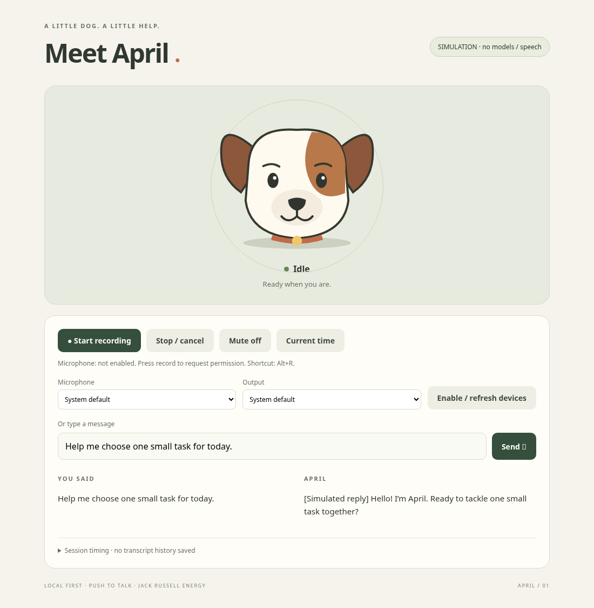

# APRIL

A local push-to-talk companion with an original cartoon Jack Russell face. Built by Enrique, a George Mason University computer science student expecting to graduate in May 2028. APRIL focuses on interactive systems, audio boundaries, hardware integration, and reliable software design. It uses pretrained models; it does not train or fine-tune them.

**Current milestone:** working browser/Python simulation demo with real microphone capture code, replaceable local backend adapters, cancellation, and a deterministic clock tool. Real voice conversation on Enrique’s desktop and physical Pi tests are **pending**. The simulation badge stays visible; simulated transcripts/replies are labeled. There is no simulated audible speech.



## Start the demo

Requires Python 3.11+ (validated with 3.12), Git, and a modern browser. No hardware purchases or API keys needed.

```bash
cd April
bash scripts/setup.sh
APRIL_MODE=simulation .venv/bin/python -m april.server
```

Open the local address printed by the server on **your own desktop**. In the cloud, use internal checks; this onboarding environment does not provide a localhost preview. Type a message, or request microphone permission and press Record twice. Alt+R toggles recording; Escape and Stop cancel. Mute suppresses response playback. The clock button calls an actual read-only server tool, bypassing the LLM.

The face states are idle, listening, transcribing, thinking, speaking and error. “Thinking” means waiting for the local response or preparing its audio, not a visualization of model reasoning. Speaking starts on the browser’s actual playback event. Simulation skips speaking and reports that playback was simulated.

## Enable local speech

1. Run `bash scripts/setup_speech.sh` to build CPU whisper.cpp. A C/C++ compiler and Make are prerequisites. Piper installs into `.venv` with setup. See [stack and licensing](docs/STACK.md) before downloading a voice.
2. Copy `april.example.toml` to `april.local.toml`. Set absolute `whisper_cli`, `stt_model`, `piper_cli` (typically the project’s `.venv/bin/piper`), and `voice` paths. The Piper `.onnx.json` must accompany the `.onnx` file. The example paths are placeholders, not bundled models.
3. Check `ollama list` and `ollama ps` on your desktop. Reuse a suitable installed model; change `model` to its exact tag. The suggested 3B tag is not a claim it is installed. Check RAM, VRAM and existing AM activity before loading anything. Do not restart or unload AM’s services/models. CPU STT and TTS keep their model data out of GPU VRAM; Ollama decides its own placement.
4. With `mode = "live"`, run `.venv/bin/python -m april.server`. First submit text to isolate Ollama/TTS. Then record one short sentence through your real microphone, confirm the transcript, hear the reply on headphones, and verify idle. Stop during another request and retry. This physical test has not been performed here.

One job runs at a time across all clients; overlapping jobs are rejected with no application queue. Recording defaults to 15 seconds, model generation to 120 tokens / 600 characters, processing to 90 seconds. Stop closes our HTTP request and terminates our speech process group. Ollama cancellation/resource release depends on the shared server; APRIL never stops that service or forces model unloading. Speech processes exit after each turn, freeing their CPU memory at the cost of cold-start latency.

## Hardware status

| Component | Intended role | Verification |
|---|---|---|
| CachyOS desktop, Ryzen 7 9700X, RX 9070 XT 16 GB, 32 GB RAM | Python server, CPU STT/TTS, Ollama | User-provided specification; OS/device/ROCm availability pending |
| Gaming microphone, headphones | Initial input/output | Device enumeration and real capture/playback pending |
| Raspberry Pi 5, 16 GB | Browser face and audio client over SSH tunnel | OS, architecture, SSH, browser and physical audio pending |
| Cloud Linux x86_64, Python 3.12, ~32.5 GiB reported RAM | Tests, CPU tool build and simulation UI | Verified; no `/dev/snd`, `/dev/dri`, or Ollama |
| Dedicated face display, speaker, enclosure | Later | Not owned; not required |

USB/3.5 mm adapters do not establish a compatible ADC/DAC. Device visibility does not prove recording quality or output routing. Test the actual microphone and headphones before buying anything.

## Checks and evidence

```bash
.venv/bin/python -m unittest discover -s tests -v
# Optional UI harness: requires Playwright, Chromium and FFmpeg in its Python environment.
python scripts/browser_smoke.py
```

The [recorded simulation walkthrough](docs/evidence/simulation-walkthrough.webm) is included in this repository. The browser harness uses fake microphone data and simulation backends. It saves actual screenshots to `docs/evidence/` and an ignored short video to `artifacts/simulation-walkthrough.webm`. [Validation report](docs/VALIDATION.md) distinguishes these checks from real models and hardware. [Timing protocol](docs/BENCHMARKS.md) describes measurements without inventing results.

## Privacy and deployment

Audio is held in browser memory and private temporary job files required by the CLI; temporary audio/text are deleted on success, failure or cancellation. There is no audio archive, transcript database, conversation history, browser local storage or transcript logging. Abrupt power loss/process kill can leave OS temporary files; use a RAM-backed temporary directory via `TMPDIR` when desired. Text remains visibly in this tab until reload. Retention is opt-in by manually copying/exporting your own exchange or recording a walkthrough; no automatic retention feature is enabled. Dependencies and model downloads require Internet access; configured inference stays local.

Configuration uses ignored `april.local.toml` or `APRIL_CONFIG`; `APRIL_MODE=simulation` explicitly overrides the mode. Never commit secrets. Default binding and Ollama endpoint are loopback only. HTTP/WebSocket host checks, strict browser-origin checks, no CORS, no external assets and a restrictive content policy reduce accidental cross-site access. This is a single-user local app, not an Internet service. [Pi deployment](docs/PI.md) uses authenticated SSH forwarding rather than exposing APRIL or Ollama on the LAN.

## Troubleshooting

| Symptom | Next check |
|---|---|
| Microphone unavailable | Use localhost or HTTPS, allow browser permission, select a real input. Plain LAN HTTP is not a secure context. |
| No or wrong audio output | Unmute, check OS routing, select output after granting device permission. Some browsers lack `setSinkId`; use system default. |
| Speech binary/model missing | Check absolute paths and execute `whisper-cli --help` / `.venv/bin/piper --help`. |
| Local backend failed | Check `ollama list`, `ollama ps`, model path/voice config compatibility; try text first. |
| Request timeout | Shorten recording/prompt, inspect resource contention and existing AM load. Never assume GPU capacity is available. |
| Busy | Stop the active interaction; APRIL deliberately has no backlog. |
| Connection closed | Restart the server and reload the tab. Disconnect cancels its active job. |
| Hugging Face 403 | Cloud model downloads require environment network settings; never disable TLS or use a policy bypass. |

## Project map

| Path | Responsibility |
|---|---|
| `april/config.py`, `april.example.toml` | Validated runtime settings |
| `april/state.py`, `april/session.py` | State transitions, serial jobs, cancellation, timing |
| `april/audio.py` | WAV format and duration validation |
| `april/backends.py` | STT subprocess, streamed Ollama, TTS subprocess, explicit fixtures |
| `april/server.py` | Local HTTP/WebSocket boundary and lifecycle |
| `april/tools.py` | Validated deterministic clock |
| `april/web/` | SVG face, capture worklet, resampling, selected-output playback |
| `tests/`, `scripts/` | Reliability checks, repeatable setup and evidence capture |
| `docs/` | Architecture, stack, Pi deployment, results and interview guide |

First-release optional features are frozen. Wake words, motors, cameras, autonomous actions, persistent personality memory, custom photo assets and enclosure design are deferred.
