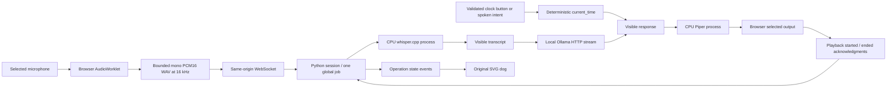
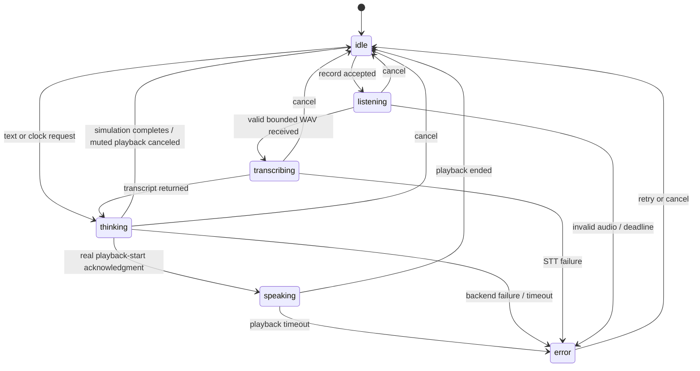

# Audio and interaction architecture

Desktop v0.1 starts through `april.sh` → `april.launch` → read-only `april.readiness` checks → existing server. Live checks list Ollama models and check local speech files; they never start a shared service or load/unload models. A UI readiness endpoint repeats these checks on demand. `BackendError` exposes fixed codes and actionable text, never raw remote responses. Piper WAV output is validated before browser handoff. This is desktop architecture; Pi-first routing is described as future work in ROADMAP.md.

The browser owns real capture/playback. The server owns the job lock and operation states. Text bypasses capture/STT. The clock tool bypasses the model; its arguments must be exactly an empty object and its timezone comes from trusted configuration. We deliberately do not pretend the LLM selected the tool.

Error text remains visible until another action; retry resets state without restarting. Each job has a processing deadline. Browser recording and server recording deadlines prevent a stuck microphone session; playback has its own deadline. Stop immediately releases browser media tracks and playback, cancels the Python task, closes the model stream, terminates only owned speech subprocesses, and releases the global lock. An acknowledgment barrier discards stale server events during browser cancellation.

No LLM-generated shell commands, model tool execution, background task queue, persistent memory, or raw-audio archive exists. The UI describes waiting as waiting; animated expressions never claim to expose model reasoning.

## Read-only retrieval path

Explicit web/documents/Gmail actions or narrow recognized phrases are selected by code, not by parsing model-generated commands. The clock is routed after transcription and bypasses the model. Specific current-fact requests require web evidence instead of stale-model fallback. Simulation rejects private/external retrieval.

Approved documents are chunked into a private SQLite FTS5 index through an explicit CLI command. Web queries use the local SearXNG JSON API; Gmail uses fixed read-only Google HTTPS endpoints after local OAuth. At most three bounded excerpts are sent to the loopback model, marked as untrusted data and identified for source references. The browser displays the actual retrieved excerpts/URLs separately from the generated answer. No recursive model-selected browsing, mail sending, attachment fetching or arbitrary shell commands exist.

Web queries are sent to the provider; private document/mail excerpts stay with the local model. Gmail bodies are not persistently indexed. The file index is an explicit local snapshot, not chat memory. OAuth tokens and API keys live outside Git. Retrieval timing is separate from generation; a no-results reply omits LLM timing because no model request occurred. All these API paths require real user setup before live-account readiness can be claimed.
