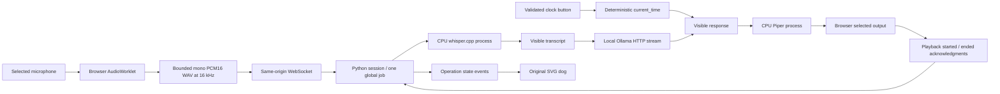
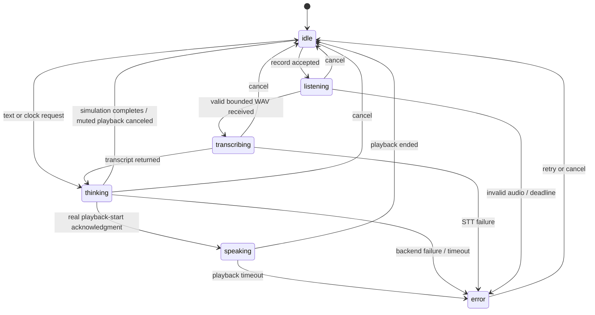

# Audio and interaction architecture

The browser owns real capture/playback. The server owns the job lock and operation states. Text bypasses capture/STT. The clock tool bypasses the model; its arguments must be exactly an empty object and its timezone comes from trusted configuration. We deliberately do not pretend the LLM selected the tool.

Error text remains visible until another action; retry resets state without restarting. Each job has a processing deadline. Browser recording and server recording deadlines prevent a stuck microphone session; playback has its own deadline. Stop immediately releases browser media tracks and playback, cancels the Python task, closes the model stream, terminates only owned speech subprocesses, and releases the global lock. An acknowledgment barrier discards stale server events during browser cancellation.

No LLM-generated shell commands, model tool execution, background task queue, persistent memory, or raw-audio archive exists. The UI describes waiting as waiting; animated expressions never claim to expose model reasoning.
