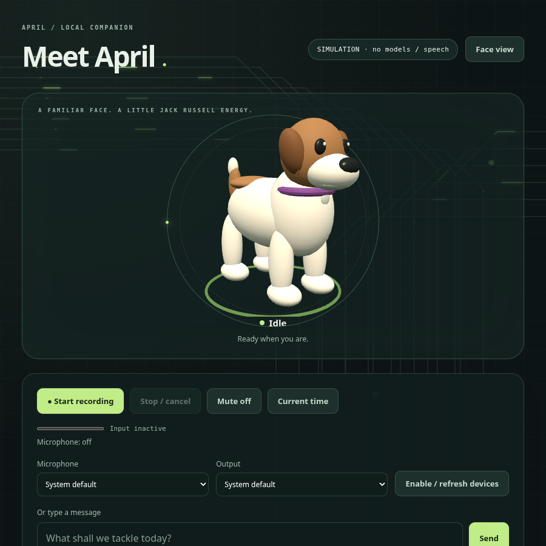

# Personal companion preview: power, 3D, debugging and private scheduling

This preview expands the desktop companion. The Pi remains a later standalone
and authenticated-offload milestone. Each capability below distinguishes working
software tests from the desktop/account acceptance still needed.

For the new persona, Markdown/Obsidian memory vault, remembering/forgetting,
private conversations and local reminder/briefing notifications, see [MEMORY.md](MEMORY.md).

For the guided login/memory/CalDAV/Google setup sequence, see [EVERYDAY_SETUP.md](EVERYDAY_SETUP.md).

## 1. One owner for April's runtime

```bash
cd ~/Projects/April
git pull --ff-only
bash scripts/setup_desktop.sh
bash scripts/setup_assistant.sh
```

Linux native capture still needs PortAudio. Screen OCR needs Tesseract and English
data:

```bash
sudo pacman -S --needed portaudio tesseract tesseract-data-eng
```

Use the existing wake model setup in WIDGET.md. Docker must be running and your
account must have socket access; one-time boot enablement is
`sudo systemctl enable --now docker`.

**Private Ollama is deliberate.** AM may share the existing port 11434. Managed
April starts its own `ollama serve` on port 11435, using one loaded model/one
parallel request and a configurable five-minute idle model keep-alive. Off can then stop that process
and release April's model without killing AM's service. A private process does
not guarantee enough VRAM if AM is concurrently using it; check contention.

Reuse your existing model store. On the desktop, inspect just its blob path:

```bash
ollama show gpt-oss:20b --modelfile | rg '^FROM '
```

The model store is the directory containing `blobs/` and `manifests/`, not the
individual blob. Set that actual readable directory in ignored local settings:

```toml
private_ollama_port = 11435
private_ollama_models = "/actual/existing/model/store"
```

No model is silently downloaded. If the configured model is not visible, startup
stops and explains the missing store. Do not change ownership of another
application's model store blindly. The new `bash april.sh setup --login` helper can discover this path on the desktop;
managed desktop acceptance is still required before calling it verified.

```bash
bash april.sh start
bash april.sh status
bash april.sh stop
```

Start runs a background supervisor; read private `artifacts/power.log` for
startup failures. Logs are truncated on launch and bounded while running. It
starts private Ollama, APRIL Search, the private calendar if configured, and the
native companion. No shared Docker daemon or AM/Ollama service is stopped.

Say **“Goodbye April”** while idle, choose **Off**, or run **stop**. This disables
April's next login launch until **start** is run manually. Off releases her owned
microphone, UI, server, private model process and calendar/search services;
calendar/index/account files remain. An explicitly started IDE debugger is
independent user work and is not killed.

After manual acceptance:

```bash
.venv/bin/python -m april.autostart install
```

Reinstall an older APRIL autostart entry to switch it to managed power. This is
after GUI login, not before login. The off marker persists across login/reboot.
Remove login registration with `python -m april.autostart remove`.

Legacy `bash april.sh --widget --with-search` remains available; it uses your
configured/shared model endpoint. Full private-runtime ownership applies to
`bash april.sh start`. While April speaks, wake detection is paused; use the Off
button for immediate interruption.

## 2. Replaceable 3D companion

The uploaded Tripo MP4 was inspected as a visual reference. It contains a
showcase video, not an editable mesh. The bundled **original procedural cartoon
prototype** is real GLB geometry, with an editable Blender source. It is not the
original Tripo model extracted from the video.




The default UI loads the GLB locally. A colored ring distinguishes I/O states. Idle breathing, head tilt, tongue and tail
motion follow interaction state/input level. Native wake popup is transparent
and model-only; click the model to expand controls. WebGL failure falls back to
the existing SVG. Native Qt offscreen WebGL is blocked in the cloud; software
WebGL rendering/click tests passed in Chromium. Native transparency/focus/GPU
behavior still needs the CachyOS test. Transparent window bounds may intercept
clicks near the model; this is not a tested click-through desktop-pet engine.

Use `avatar_3d = false` for the browser SVG, or change `avatar_model_url` to your
own local GLB. Named clips and source/export details are in
[tools/README.md](../tools/README.md). Custom personal assets should not be
published accidentally. The original personal video is not bundled.

Free/open-source authoring choices:
- **[Blender](https://www.blender.org/)**: recommended complete modeling, rigging
  and animation workflow; open the included `tools/april-prototype.blend`.
- **[Blockbench](https://www.blockbench.net/)**: beginner-friendly browser/desktop
  low-poly editor, GPL-3.0.
- **[SculptGL](https://stephaneginier.com/sculptgl/)**: MIT browser sculpting;
  transfer to Blender for rigging and animation.

## 3. “Hey April, debug this”

After wake, say **“debug this”**. April opens the deeper review panel; you choose
a screen/window through the browser picker or name a Python file relative to
`~/Documents/aprilfiles`.

- Screen review captures **one explicit snapshot**, downsizes it, runs local
  Tesseract OCR and passes text to the local model. Tracks stop immediately.
  No continuous monitoring or cloud vision is enabled. OCR can misread code,
  indentation and line numbers.
- File review reads actual approved Python text, numbers its lines and performs
  a real syntax parse before local-model hints. It does not claim runtime
  correctness from a successful parse.
- Only a user click approves execution. The token is single-use/expiring, and a
  changed file requires re-review. The selected entry point is copied to an
  immutable temporary snapshot before running.
- The runner uses a networkless, non-root, read-only, capability-restricted
  container: 10 seconds, 256 MB, one CPU, 64 PIDs, 16 KB output. Only aprilfiles
  and the reviewed snapshot are mounted; separate credential stores, home and the
  Docker socket are not. Anything you put inside aprilfiles remains readable
  to the approved program, so keep secrets outside it.
  Proxy environment is blanked. Cleanup removes only the unique owned container.
- Non-interactive Python, approved local modules and data files are the initial
  execution target; third-party libraries are not installed in the runner. Third-party project dependency
  setup, other languages, automatic fixes and persistent visual monitoring are
  not implemented.

Prepare the execution image explicitly; execution itself never pulls images:

```bash
docker pull python:3.12-slim@sha256:e695ab189fa2d082b1c61c69a6b888a5adeca61ceeccad107b1ed2a125721a9e
```

The runner uses `debug_runner_image` from configuration, pinned by digest. Review and update this setting explicitly for security updates; execution never changes or downloads an image. Record the resolved image digest for reproducibility. The cloud public-fixture
run used digest
`sha256:e695ab189fa2d082b1c61c69a6b888a5adeca61ceeccad107b1ed2a125721a9e`.
This is a constrained runner, not proof of isolation against every container or
kernel vulnerability. The approved directory must contain only material you
intend the program/model to read.

[VS Code extension preview](../editors/vscode/README.md) provides real Python
syntax diagnostics, deeper review and a separate explicitly approved debugpy
launch. Optional on-save syntax checking applies only to approved saved files.
IDE execution uses normal desktop permissions, unlike the container. The
extension's JavaScript syntax was checked; actual VS Code behavior is pending.

## 4. Private open-source CalDAV calendar

Radicale (GPL-3.0) is a self-hosted calendar server. APRIL uses a dedicated
collection. Thunderbird can also connect as an open-source calendar client.

```bash
.venv/bin/python -m april.calendar_setup init
.venv/bin/python -m april.calendar_setup serve
```

The init command creates a strong random password, SHA512 htpasswd record,
private mode-600 credentials/config outside Git and local persistent calendar
storage. It refuses to replace existing setup files. It binds only
`127.0.0.1:5232`. Initial default collection:
`http://127.0.0.1:5232/april/assistant/`.

While that server runs, use another terminal from the repository:

```bash
.venv/bin/python -m april.calendar_setup create
```

Stop the temporary foreground calendar server with Ctrl+C before handing
ownership to `bash april.sh start`. Managed power starts the configured calendar
and stops its owned process on Off. Use authenticated HTTPS or a local tunnel
if moving the calendar to a home server/Pi; do not publish unauthenticated
CalDAV or send credentials over remote plain HTTP.

Read the next seven days through the calendar panel, or ask “What do I have
planned this week?”. Create an event through the form. Voice prefixes such as
“Schedule a meeting …” or “Add an event …” request a local-model draft; missing
or invalid times fail validation. The displayed title and timezone-aware
start/end must be confirmed before any PUT.

For editing, read the list, choose an April-created event, modify fields, review
and confirm. ETags reject concurrent edits; expired/replayed approvals cannot
write. Recurring/invitation events require a calendar client; there is no DELETE
or invitation API. Unrelated calendar resources cannot be selected as write
targets. Calendar data persists after Off.

Actual authenticated Radicale create/read/update/conflict tests passed with
temporary public events. Enrique's actual calendar is not configured by cloud
tests. This preview reads a bounded next-seven-day range, not an unlimited
calendar history.

## 5. Gmail reader and recaps

No Google client has been created yet, and no personal account is connected.
Use [INTEGRATIONS.md](INTEGRATIONS.md) for the full Google setup:

1. Create/select your Google Cloud project and enable Gmail API.
2. Configure consent/audience; add yourself as a test user if needed.
3. Create a **Desktop app** OAuth client and download its JSON outside the repo
   and outside aprilfiles, for example `~/.config/april/google-client.json`.
4. Run on your own desktop:

```bash
.venv/bin/python -m april.gmail connect --client ~/.config/april/google-client.json
```

Approve only `gmail.readonly`. Do not paste JSON, passwords or tokens into chat.
The token is stored privately outside Git. April cannot send/delete mail.

“Summarize my emails” reads bounded recent mail; “Any internship updates”
searches recent internship/interview/recruiter/application messages. “Brief me
on my day” / the recap button combines upcoming calendar events with recent
mail. Results are capped (up to three calendar and three email excerpts), so the
answer is not an exhaustive inbox audit. Missing service/authentication reports
an error rather than a fabricated briefing.

Gmail fixture checks passed previously; real Google authorization and mailbox
queries remain pending. Newly created Google testing-mode grants can expire;
follow the reconnect/disconnect guidance in INTEGRATIONS.md.

## Acceptance and remaining goals

Verified in the cloud: original Blender/GLB output; actual software-WebGL render
and click event; SVG fallback in offscreen Qt; bounded OCR on public fixture;
read-only actual container execution plus changed-file rejection; authenticated
Radicale CRUD subset/conflict protection; existing playback regressions and unit
tests. Managed private Ollama needs the actual readable desktop model store.
Real wake, transparency, power/log-in cycle, screen portal, Gmail consent and
VS Code are still desktop acceptance work.

Next: verify this desktop flow with real devices/accounts, improve/customize the
3D character and animation, then migrate always-on coordination to the Pi.
Calendar on the Pi/home server will remain accessible while the desktop is off.
Standalone Pi inference, authenticated offload/fallback, persistent personal
memory, autonomous code edits and sending email remain future work.
