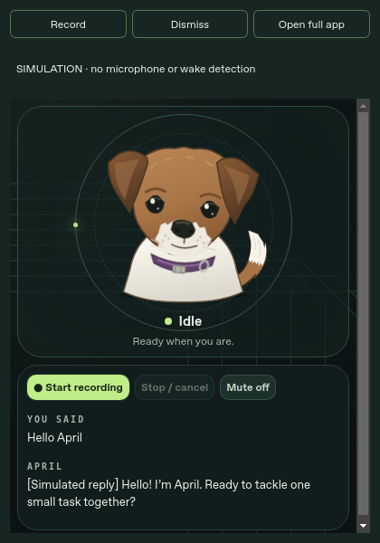

# APRIL desktop companion: wake phrase, popup and login startup

**Upgrade note:** [ASSISTANT.md](ASSISTANT.md) supersedes service ownership, 3D
appearance and managed login startup. The legacy standalone widget commands
below remain supported. New autostart entries use managed power and need the
readable existing model store configured first.

This is an optional desktop client, not a newly trained model. The existing
Whisper → Ollama → Piper pipeline is unchanged. A small Vosk CPU recognizer
listens locally for “hey april” or “okay april”; only after a trigger does APRIL
record a command and send it to the existing loopback server. The native Qt
window reuses April's code-rendered face and true interaction states.

The ordinary browser app and push-to-talk remain available. This milestone does
not implement Calendar, personal memory, autonomous actions or Pi offloading.

## Install on the CachyOS desktop

Stop the existing APRIL terminal process first (Ctrl+C). Leave AM services intact.

```bash
cd ~/Projects/April
git pull --ff-only
sudo pacman -S --needed portaudio
bash scripts/setup_desktop.sh
.venv/bin/python -m april.wake_setup --download
bash april.sh --widget --with-search
```

The optional Qt packages download roughly 250 MB plus their dependencies; the
separate English wake model archive is roughly 40 MB. No CUDA, paid API or model
training is required. Review the official [model list and model-specific
license](https://alphacephei.com/vosk/models) before downloading
`vosk-model-small-en-us-0.15`. The downloader uses the official HTTPS URL, bounds
archive/download size and rejects traversal/symlink entries; it does not have an
independently verified upstream checksum. Existing models are never replaced.
There are no silent startup downloads.

If Docker/Ollama are stopped, explicitly start the existing services:
`sudo systemctl start docker ollama`. The widget never starts/stops shared
services itself. `--with-search` starts only APRIL's dedicated search container.

## First real test

Say **“Hey April”**, pause for the window to appear, then say **“What time is it?”**.
The command should finish after about one second of silence, produce a visible
transcript, speak the actual local time and return to idle. Say the wake phrase
separately; same-breath “Hey April, do this…” is not supported reliably yet.

The window is always-on-top where the compositor permits, near the bottom right.
KDE Wayland may decline focus stealing: use the tray icon if the popup does not
come forward. It does not require a browser tab or a browser search bar.

- **Record** in the window/tray is the manual fallback. The in-face recording
  button can finish a recording early.
- **Dismiss** or closing the window cancels the turn and returns to the tray.
  Without a tray host it minimizes, so there is still a way to restore it.
- **Pause microphone** in the tray releases capture and disables wake/manual
  recording until resumed. **Mute** in the face controls response playback only.
- **Retry microphone** retries a missing model/device after you fix it.
- **Quit April** releases the mic/CPU wake model and stops only its owned server.
  The search container and shared Ollama/Docker are left running.
- After a completed response, the popup hides after five seconds by default.
  Errors stay visible; failed searches do not quietly invent answers.
- **Open full app** opens the normal page for sources/setup. Prefer one active
  conversation client at a time; the global backend lock still permits one turn.

Wake recognition is disabled while a command is being processed or played and
has a cooldown before rearming. This is half-duplex, not reliable interruption
by saying the wake phrase over April's voice. Stop/cancel remains available.

## Configure the native microphone and behavior

Browser device IDs do not select native PortAudio devices. List native names:

```bash
.venv/bin/python -c 'import sounddevice as sd; print(sd.query_devices())'
```

Add overrides to ignored `april.local.toml`, then restart:

```toml
wake_model = "models/vosk-model-small-en-us-0.15"
wake_phrases = ["hey april", "okay april"]
desktop_input_device = "default" # Or an actual PortAudio input name
wake_silence_seconds = 1.0
wake_speech_wait_seconds = 5
wake_cooldown_seconds = 1.2
wake_rms_threshold = 0.015
widget_width = 420
widget_height = 600
widget_hide_seconds = 5 # 0 leaves the window visible
```

Widget playback uses the system-default output; choose headphones/output in KDE audio settings. Browser device IDs do not select Qt playback hardware.

Native recording requires mono PCM16 capture at 16 kHz. If opening that format
fails, choose a compatible PipeWire/ALSA input; actual adapters/microphones must
be tested. Loud rooms can trigger false wakes or extend recordings; energy-based
endpointing is deliberately simple and capped by `max_record_seconds` (15 by
default). Raise the energy threshold for background noise; lower it for quiet
speech. Wake sensitivity/accuracy has not been measured on Enrique's microphone.

## Start automatically after desktop login

First complete the real test above. Then explicitly enable the existing shared
services if you want them at boot and install APRIL's user login entry:

```bash
sudo systemctl enable --now docker
.venv/bin/python -m april.autostart install
```

This writes only `~/.config/autostart/april.desktop` (or your XDG config folder).
It now launches the managed `april.power start --login` supervisor after GUI login, not
before login. It preserves unrelated startup entries and rejects symlinks.
A lock prevents duplicate widgets; a busy APRIL port is reported, never killed.
If startup fails, run the same command in Konsole to see the error. This is a
login launcher, not a watchdog that restarts the whole application after a crash.

Remove login startup without uninstalling APRIL:

```bash
.venv/bin/python -m april.autostart remove
```

You can also manage the entry in KDE System Settings → Autostart. No cloud
installer modifies your actual desktop login or service configuration.

## Privacy, dependency choices and limitations

Idle wake audio is processed in memory by the CPU recognizer, not transmitted,
saved, indexed or sent to the LLM. After activation, only the bounded command
recording goes to loopback Whisper. Ordinary command text can trigger configured
web lookup, as documented in [INTEGRATIONS.md](INTEGRATIONS.md); private routes
remain separate. Anyone nearby or a recording can trigger the wake phrase: it
is **not authentication** and must not authorize consequential actions.

Vosk is Apache-2.0 software with a small streaming recognizer and configurable
vocabulary. Its Python release 0.3.45 is older; it is used here as a constrained
speech recognizer, not presented as a newly trained or benchmarked wake-word
model. A dedicated wake detector can replace it after measured false/missed-wake
testing; custom “April” support is the reason for this initial choice.
Sounddevice is MIT and wraps PortAudio. PySide6 uses LGPLv3/GPL/commercial options;
the wheel's Qt/Chromium dependency notices apply. It is a substantial optional
dependency, chosen to reuse the tested SVG/UI rather than build a second face.

Primary sources:
[Vosk](https://github.com/alphacep/vosk-api),
[streaming microphone example](https://github.com/alphacep/vosk-api/blob/master/python/example/test_microphone.py),
[sounddevice](https://github.com/spatialaudio/python-sounddevice),
[Qt-for-Python licensing](https://github.com/pyside/pyside-setup/blob/6.10/README.pyside6.md).
The official model-list endpoint returned HTTP 403 in the managed cloud; no live
model download/recognition is claimed there. Review it on your desktop.

## What has actually been tested

Core tests cover phrase matching, silence/noise deadlines, valid bounded WAV
output, half-duplex worker/cancellation using fake audio and recognizer, archive
safety and scoped autostart generation. Actual offscreen QtWebEngine connected to
a fixture server, displayed April and simulated replies, accepted the native WAV
bridge and restored after dismissal. These are **not** real wake/hardware tests.
An actual simulation screenshot is below; simulation never opens the microphone.



Pending desktop acceptance: at least ten intentional wake attempts, five minutes
of ordinary room audio to count false wakes, Stop/dismiss during recording and
playback followed by retry, microphone pause/resume, system-default audio output, KDE
tray/focus behavior, logout/login launch, and CPU/RAM/latency measurements.
Pi packaging and desktop-offload/fallback remain separate future milestones.

The native launcher also passed actual simulation subprocess checks for SIGINT
and SIGTERM, releasing its owned server after exit. Run
`.venv/bin/python scripts/widget_lifecycle_check.py` to reproduce that lifecycle
test. Window close still dismisses to tray; explicit Quit exits the application.
